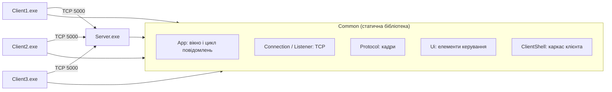
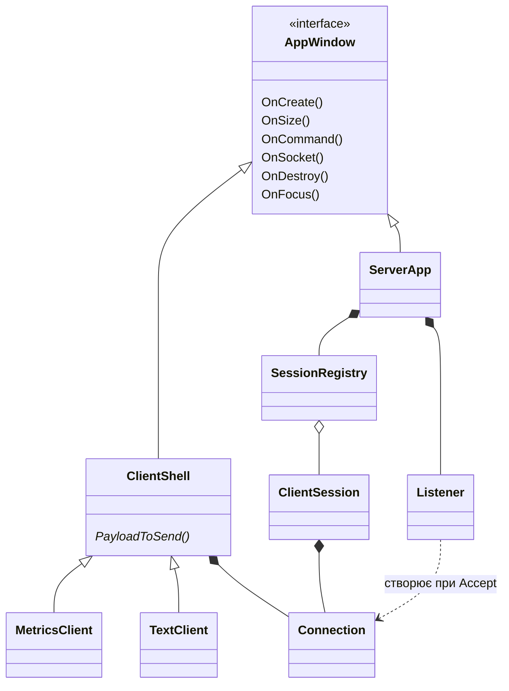
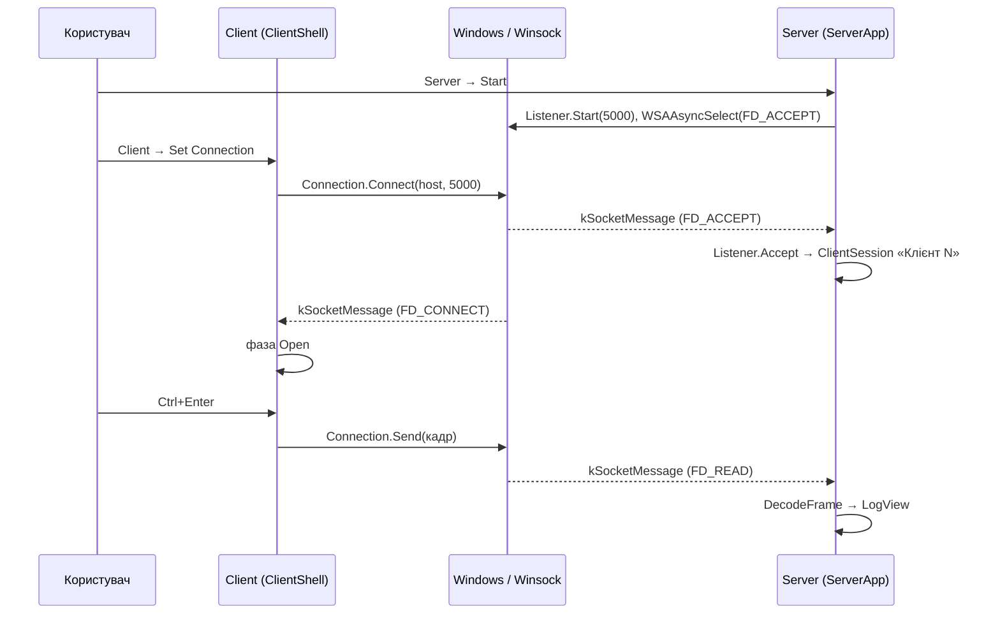

# Архітектура

## Складові рішення

Рішення складається з п'яти проєктів. Чотири з них це виконувані файли, п'ятий, `Common`, це статична бібліотека з усім спільним кодом. Змінивши файл у `Common`, перезбирають усі чотири застосунки.

## Обов'язки класів

### Вікно і цикл повідомлень (`App.h`)

| Тип | Обов'язок |
| --- | --- |
| `AppWindow` | Інтерфейс вікна: `RunApp` викликає його методи `OnCreate`, `OnSize`, `OnCommand`, `OnSocket`, `OnDestroy`, `OnFocus`. Саму оконну процедуру приховано в `App.cpp`. |
| `RunApp` | Реєструє клас вікна, створює вікно за `WindowSpec`, будує меню, ставить гарячі клавіші і крутить цикл повідомлень. На час роботи тримає `WinsockSession`. |
| `WindowSpec`, `Shortcut`, `MenuItem`, `MenuPopup` | Дані для `RunApp`: розмір і позиція вікна, гарячі клавіші, пункти меню. |

### Мережа (`Connection.h`, `Protocol.h`)

| Тип | Обов'язок |
| --- | --- |
| `WinsockSession` | RAII над `WSAStartup`/`WSACleanup`. Помилку запуску можна перевірити через `Error()`. |
| `Connection` | Одне TCP-з'єднання. Підключається (перебираючи адреси хоста), приймає і віддає кадри, повідомляє про події через `ConnectionHandlers`. Усі події сокета приходять як віконне повідомлення `kSocketMessage` (`WSAAsyncSelect`). |
| `ConnectionHandlers` | Чотири зворотні виклики: `message` (отримано текст), `fault` (помилка), `closed` (з'єднання закрито), `connectResult` (результат підключення). |
| `Listener` | Слухає порт, віддає прийняті з'єднання як `Connection` через `Accept`. |
| `EncodeFrame`, `DecodeFrame` | Пакування тексту в кадр і розпакування з буфера. Формат описано в [протоколі](protocol.md). |

### Інтерфейс (`Ui.h`)

| Тип | Обов'язок |
| --- | --- |
| `Button` | Кнопка з командою; можна вмикати і вимикати. |
| `LogView` | Нередагований журнал. Префікс рядка залежить від `LogKind`: `→` надіслано, `←` отримано, `!` помилка, без префікса інформація. Обрізає найстаріші рядки, коли журнал переповнюється. |
| `ComposePanel` | Багаторядкове поле введення з кнопкою «Send». Знає, чи є в полі текст, вмикає і вимикає кнопку, очищає поле після надсилання. |
| `ClientList` | Список підключених клієнтів на сервері, з вибором поточного. |
| `StatusBar` | Рядок стану: ліворуч стан (`SetState`), праворуч підказка або сповіщення (`SetNotice`). |
| `LayoutComposeBelow`, `LayoutChat` | Розкладка: журнал зверху, поле введення знизу. |

### Клієнти (`ClientShell.h`, `MetricsClient.h`, `Client*.cpp`)

| Тип | Обов'язок |
| --- | --- |
| `ClientShell` | Спільний каркас для всіх клієнтів: вікно, меню, журнал, рядок стану, життєвий цикл з'єднання (Idle, Connecting, Open, Closing), таймаут відключення. Це шаблонний метод: загальні кроки в базовому класі, відмінності у віртуальних методах. |
| `ClientProfile` | Дані, якими клієнти відрізняються: клас вікна, заголовок, зсув по осі X, підпис команди надсилання, розмір. |
| `MetricsClient` | Клієнт, що надсилає рядок, зібраний функцією `Collector`. Використовують Client 1 і Client 2. |
| `TextClient` (у `Client3.cpp`) | Клієнт, що надсилає текст із `ComposePanel`. |

Точки розширення `ClientShell` (віртуальні методи):

| Метод | Для чого |
| --- | --- |
| `PayloadToSend` | Що надіслати (обов'язково перевизначити). |
| `CreateControls`, `LayoutControls`, `HandleControlCommand` | Власні елементи керування. |
| `SyncControls(Phase)` | Увімкнути або вимкнути елементи за станом з'єднання. |
| `CanSend`, `OnSent` | Чи можна надсилати зараз і що зробити після надсилання. |
| `OpenHint`, `FocusPrimaryInput` | Підказка в рядку стану і куди ставити фокус. |
| `ExtraClientItems`, `OnExtraCommand` | Додаткові пункти меню `Client`. |

### Сервер (`Server.cpp`)

| Тип | Обов'язок |
| --- | --- |
| `ServerApp` | Вікно сервера: запуск і зупинка прослуховування, прийом клієнтів, показ повідомлень, надсилання обраному клієнту, відключення. |
| `ClientSession` | Один підключений клієнт: числовий ідентифікатор, назва («Клієнт N»), його `Connection`, прапорці `closing` і `faulted`. |
| `SessionRegistry` | Таблиця сесій за сокетом, пошук за сокетом або ідентифікатором, закриття всіх. |

### Допоміжне

| Файл | Що містить |
| --- | --- |
| `Text.h` | `Widen` і `Narrow`: перетворення UTF-8 ⇄ UTF-16. |
| `Endpoint.h` | Порт за замовчуванням (5000), хост за замовчуванням (`localhost`), розбір хоста з командного рядка. |
| `NetError.h` | Коди помилок надсилання і види збоїв `ConnectionFault`; `DescribeWinsockError` і `DescribeFault` перетворюють їх на текст для користувача. |
| `Units.h`, `Win.h` | Константи розмірів і підключення `windows.h` з потрібними визначеннями. |

## Як класи пов'язані

## Потік подій

Усе відбувається в одному потоці: потоці вікна. Мережевий код ніколи не блокує, а замість окремого потоку чекання операційна система сама надсилає у вікно повідомлення `kSocketMessage` через `WSAAsyncSelect`. Тому зворотні виклики `ConnectionHandlers` виконуються в потоці інтерфейсу і можуть безпечно змінювати елементи вікна.

## Відключення

- **Клієнт** обирає `Client → Disconnect`: надсилається `Shutdown`, після чого клієнт чекає закриття від сервера. Якщо сервер не відповів за 5 с, спрацьовує таймер і з'єднання закривається примусово.
- **Сервер** обирає `Client → Disconnect Client`: сесія позначається як `closing`, виконується `Shutdown`, а таймер на 5 с (`kLingerMilliseconds`) видаляє сесію, якщо клієнт не закрив з'єднання сам.
- **Зупинка сервера** (`Server → Stop`): закриваються всі сесії одразу.

## Обмеження

- Підпис «Клієнт N» у списку сервера залежить від порядку підключення. Текст, який Client 1 і Client 2 надсилають, містить власний номер («Клієнт 1 | …»), тож ці два номери можуть не збігатися.
- Перевірено збирання Debug ARM64 і наскрізний запуск (сервер плюс три клієнти). Release та x64 не перевірялися.
